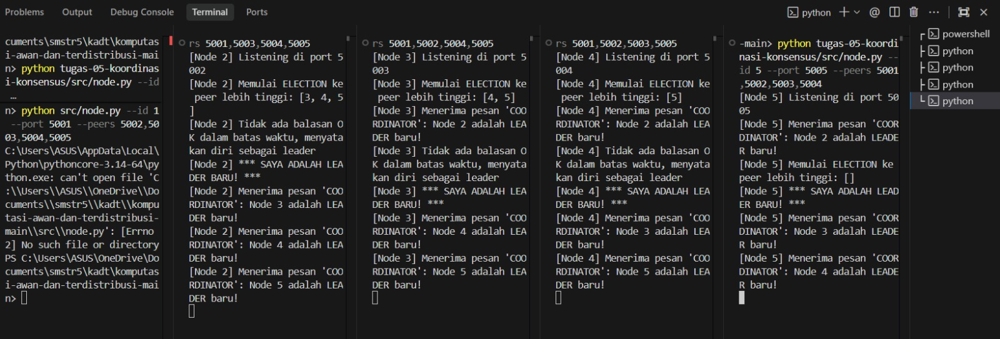
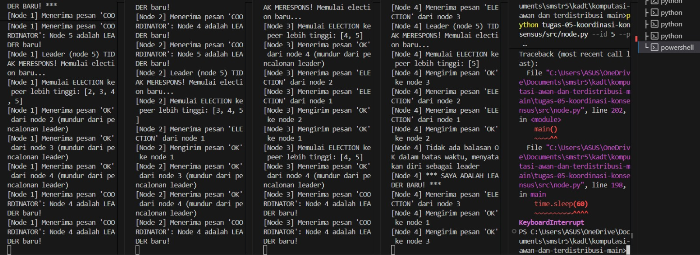

# Tugas 5 (Pekan 5) — Koordinasi & Konsensus

**Materi terkait:** Physical/Logical Clock, Election Algorithm (Bully/Raft).

## Studi Kasus

Terjadi konflik urutan waktu pada pesanan FoodGo (dua server mencatat urutan pesanan berbeda karena jam tidak sinkron), dan sistem membutuhkan satu **"Node Leader"** untuk mengelola antrean pesanan pusat agar tidak terjadi konflik pemrosesan ganda.

## Tugas Kelompok

Implementasikan simulasi **Bully Algorithm** untuk memilih leader di antara **5 node virtual** yang berjalan sebagai 5 proses Python terpisah di laptop yang sama (tiap node = satu proses di port berbeda, komunikasi lewat TCP socket di `localhost`).

Skeleton yang disediakan (`src/node.py`) sudah menangani bagian **infrastruktur jaringan** (membuka socket, menerima & mengirim pesan antar node) — bagian **algoritma Bully sendiri sengaja dikosongkan** (`# TODO`), karena itu inti pembelajaran tugas ini.

### Aturan Bully Algorithm yang harus diimplementasikan

1. Node yang mendeteksi leader tidak merespons (atau saat start pertama kali) mengirim pesan `ELECTION` ke semua node dengan ID **lebih besar** darinya.
2. Jika ada node ber-ID lebih besar yang merespons `OK`, node yang memulai election **berhenti mencalonkan diri** dan menunggu pesan `COORDINATOR`.
3. Jika **tidak ada** node ber-ID lebih besar yang merespons dalam batas waktu tertentu, node tersebut menjadi leader dan mem-broadcast `COORDINATOR` ke semua node lain.
4. Semua node mencatat siapa leader saat ini.

### Cara Menjalankan

Buka 5 terminal terpisah (satu per node):
```bash
python3 src/node.py --id 1 --port 5001 --peers 5002,5003,5004,5005
python3 src/node.py --id 2 --port 5002 --peers 5001,5003,5004,5005
python3 src/node.py --id 3 --port 5003 --peers 5001,5002,5004,5005
python3 src/node.py --id 4 --port 5004 --peers 5001,5002,5003,5005
python3 src/node.py --id 5 --port 5005 --peers 5001,5002,5003,5004
```

### Skenario Wajib Diuji & Dicatat

1. **Start normal**: nyalakan node 1–5 hampir bersamaan, catat siapa yang terpilih jadi leader (harusnya node ber-ID tertinggi, yaitu node 5).
2. **Leader mati**: matikan (Ctrl+C) proses node leader (node 5), amati node lain mendeteksi leader hilang dan memicu election baru. Catat leader baru yang terpilih (harusnya node 4).
3. Simpan log terminal (screenshot atau `> log_nodeX.txt` redirect) dari kedua skenario ke folder `bukti/`.

## Struktur Submission

```
tugas-05-koordinasi-konsensus/
├── README.md      # Analisis: kenapa perlu leader, kenapa Bully (vs Raft), hasil 2 skenario
├── JURNAL.md
├── src/
│   └── node.py
└── bukti/          # Log/screenshot skenario start normal & leader mati
```

## Rubrik Penilaian (Tugas 5)

| Komponen | Bobot | Kriteria |
|---|---|---|
| Implementasi Bully Algorithm benar | 35% | Election, OK, COORDINATOR message bekerja sesuai aturan algoritma |
| Bukti skenario leader mati → re-election | 30% | Log jelas menunjukkan leader baru terpilih otomatis |
| Analisis (kenapa perlu leader, trade-off Bully vs Raft) | 20% | Dikaitkan ke masalah urutan pesanan di skenario FoodGo |
| Proses & kontribusi kelompok | 15% | `JURNAL.md`, commit history |

## Batasan Penggunaan AI (Level 2)

Kebijakan **Level 2 (AI Assisted Idea Generation & Structuring)** berlaku — lihat [`../RUBRIK-UMUM.md`](../RUBRIK-UMUM.md). Boleh bertanya ke AI tentang gambaran umum algoritma election; **tidak boleh** meminta AI menuliskan isi `# TODO` di `src/node.py` (logika `on_message`, `start_election`, `declare_leader`, `monitor_leader`). Catat pemakaian AI di "Log Penggunaan AI" pada `JURNAL.md`.

- `README.md` wajib menjelaskan kenapa Bully Algorithm selalu memilih node ber-ID tertinggi yang masih hidup, dan apa kelemahannya dibanding algoritma lain (mis. jumlah pesan yang dikirim saat election, single point of failure sebelum leader baru terpilih) — bukan sekadar definisi generik.

---

# Laporan Submission Kelompok 3 — Koordinasi & Konsensus

**Kelompok:** Kelompok 3  

| Nama | NIM | Kontribusi |
|---|---|---|
| Stefanus Andri Hendrawan | 103072400115 | Implementasi logika Bully Algorithm (`src/node.py` TODO 1–4), perbaikan konkurensi socket dan encoding console platform, pengujian Skenario 1 & Skenario 2. |
| Fatih Khairu Alfifiajri | 103072400105 | Analisis kebutuhan koordinasi terdistribusi pada studi kasus FoodGo, analisis pemilihan node ber-ID tertinggi, dan dokumentasi `JURNAL.md`. |
| Moh Irham Maulana A.S | 103072400063 | Analisis komparasi trade-off arsitektur (Bully Algorithm vs Raft Consensus), evaluasi kompleksitas pesan dan fault tolerance, penyusunan laporan serta validasi artefak bukti di `bukti/`. |

---

## 1. Studi Kasus FoodGo: Mengapa Sistem Membutuhkan Node Leader?

### 1.1 Masalah Clock Drift dan Urutan Waktu
Dalam sistem terdistribusi multi-server seperti FoodGo, setiap mesin server memiliki *physical clock* internal masing-masing (berbasis osilator kuarsa). Secara fisik, jam perangkat keras selalu mengalami fenomena **clock drift** dan **clock skew** (perbedaan kecepatan laju dan nilai waktu aktual). Protokol sinkronisasi jaringan seperti NTP (*Network Time Protocol*) hanya dapat meminimalkan selisih waktu hingga rentang beberapa milidetik, namun tidak pernah dapat menjamin sinkronisasi waktu mutlak (*absolute synchronization*) dengan ketepatan nol milidetik.

Ketika dua server pesanan FoodGo (misalnya Server A dan Server B) menerima pesanan dari pengguna yang berbeda pada waktu yang hampir bersamaan:
1. Server A mencatat `Pesanan #101` pada pukul `12:00:00.005`.
2. Server B mencatat `Pesanan #102` pada pukul `12:00:00.002` (karena jam lokal Server B sedikit tertinggal/lebih lambat).
3. Secara fisik di dunia nyata, Pesanan #101 mungkin terjadi terlebih dahulu sebelum Pesanan #102. Namun berdasarkan stempel waktu lokal (*timestamp*), sistem mengira Pesanan #102 terjadi lebih dulu.

### 1.2 Konflik Pemrosesan Ganda & Solusi Node Leader
Ketidaksesuaian stempel waktu ini berakibat fatal pada logika bisnis FoodGo:
- **Konflik Alokasi Stok:** Jika stok makanan terbatas (misalnya sisa 1 porsi menu promo), dua server dapat secara independen mengonfirmasi pesanan ke dua pelanggan berbeda karena keduanya menganggap pesanannya masuk lebih dulu.
- **Konflik Pemrosesan Ganda (*Double Processing*):** Terjadi perebutan antrean pemrosesan di dapur restoran dan penugasan mitra kurir.

Sistem membutuhkan satu **Node Leader** terpusat yang bertindak sebagai **Single Source of Truth** untuk mengelola antrean pesanan pusat (*Centralized Order Queue*). Semua server pesanan tidak lagi memutuskan urutan berdasarkan jam lokal masing-masing, melainkan meneruskan pesanan ke Node Leader. Node Leader menentukan **Total Ordering** (urutan global pasti) untuk setiap pesanan yang masuk, sehingga pemrosesan pesanan berlangsung deterministik dan bebas konflik.

---

## 2. Analisis Bully Algorithm

### 2.1 Mengapa Bully Algorithm Selalu Memilih Node Ber-ID Tertinggi yang Masih Hidup?
Bully Algorithm mengasumsikan bahwa setiap node dalam sistem memiliki pengenal unik (*Node ID*) yang dapat diurutkan secara total ($ID_1 < ID_2 < \dots < ID_N$) dan semua node mengetahui ID serta alamat port node lainnya.

Mekanisme algoritma ini dirancang secara sengaja untuk memberikan prioritas mutlak kepada node dengan ID tertinggi:
1. Ketika suatu node mendeteksi kegagalan leader, node tersebut hanya mengirim pesan `ELECTION` ke node-node yang memiliki **ID lebih besar** darinya.
2. Setiap node dengan ID lebih tinggi yang masih hidup berhak "mengintimidasi" (*bully*) node di bawahnya dengan membalas pesan `OK` (yang bermakna: *"Mundur, saya masih aktif dan peringkat saya lebih tinggi"*). Node pengirim yang menerima `OK` diwajibkan mundur dari pencalonan.
3. Node ber-ID lebih tinggi tersebut kemudian mengambil alih proses election dan menantang node di atasnya lagi.
4. Proses ini berlanjut secara hierarkis sampai ke node dengan ID terbesar di antara node-node yang masih aktif. Karena tidak ada node lain yang memiliki ID lebih tinggi darinya, tidak ada node yang dapat mengirimkan balasan `OK` kepadanya. Setelah batas waktu `ELECTION_TIMEOUT` berakhir tanpa balasan `OK`, node ber-ID tertinggi tersebut mendeklarasikan diri sebagai leader dan menyiarkan pesan `COORDINATOR` ke seluruh sistem.

### 2.2 Kelemahan dan Keterbatasan Bully Algorithm

Meskipun sederhana dan deterministik, Bully Algorithm memiliki beberapa kelemahan mendasar dalam sistem terdistribusi modern:

1. **Overhead Pesan yang Sangat Tinggi ($O(N^2)$):**
   - Pada skenario terburuk (*worst-case*), yaitu ketika node ber-ID terendah (Node 1) mendeteksi kegagalan leader dan memulai election, Node 1 akan mengirim pesan ke $N-1$ node. Node 2 kemudian mengirim ke $N-2$ node, dan seterusnya.
   - Total pesan yang dipertukarkan selama pemilihan mencapai:
     $$\sum_{i=1}^{N-1} i = \frac{(N-1)N}{2} \in O(N^2)$$
   - Hal ini membebani lalu lintas jaringan secara signifikan seiring bertambahnya jumlah node.

2. **Single Point of Failure (SPOF) Sementara & Jeda Layanan:**
   - Ketika leader mati, terdapat celah waktu ketidaksediaan sistem (*system unavailability*) selama interval deteksi detak jantung (`monitor_leader`) ditambah `ELECTION_TIMEOUT` sebelum leader baru diakui secara global.
   - Selama jeda ini, antrean pesanan pusat tidak dapat memproses data karena belum ada koordinator yang aktif.

3. **Masalah Node Instabil / "Flapping Highest Node":**
   - Jika node dengan ID tertinggi (misal Node 5) mengalami gangguan intermiten (sering crash dan restart dalam waktu singkat), Node 5 akan terus-menerus memicu election baru setiap kali hidup kembali dan merebut kepemimpinan dari leader yang sedang stabil (misal Node 4). Fenomena ini memicu *thrashing* dan pemborosan komputasi.

4. **Ketiadaan Toleransi Terhadap Partisi Jaringan (*Network Partition / Split-Brain*):**
   - Bully Algorithm mengasumsikan jaringan andal (*reliable network*). Jika terjadi partisi jaringan (misalnya kabel terputus sehingga Node 1-3 terpisah dari Node 4-5), kelompok Node 1-3 yang tidak dapat menghubungi Node 4-5 akan mengira keduanya mati dan mengangkat Node 3 sebagai leader. Sementara itu, kelompok Node 4-5 mengangkat Node 5 sebagai leader. Akibatnya tercipta **dua leader sekaligus (Split-Brain)**, yang berujung pada korupsi data.

---

## 3. Analisis Komparasi: Bully Algorithm vs Raft Consensus

| Aspek Komparasi | Bully Algorithm | Raft Consensus |
|---|---|---|
| **Kriteria Pemilihan Leader** | Berdasarkan peringkat statis (**Node ID tertinggi** yang aktif). Node ber-ID tinggi selalu menang tanpa memandang kondisi data. | Berdasarkan **dukungan suara mayoritas (Quorum)** dan **kelengkapan log transaksi** (*Up-to-Date Log*). |
| **Resistensi Split-Brain** | **Rentan:** Tidak memiliki konsep quorum; jika terjadi partisi jaringan, setiap partisi dapat memilih leadernya sendiri. | **Kuat:** Memerlukan suara mayoritas mutlak ($\lfloor N/2 \rfloor + 1$) untuk memilih leader dan mengomit log. Partisi minoritas tidak akan pernah bisa membentuk leader. |
| **Beban Pesan (*Message Overhead*)** | $O(N^2)$ pada kasus terburuk (semua node berjenjang mengirim election ke node lebih tinggi). | $O(N)$ per putaran pemilihan (*Leader Election* via RPC `RequestVote`). |
| **Replikasi Data & Konsensus** | Hanya algoritma pemilihan leader (tidak mencakup mekanisme replikasi data terdistribusi). | Solusi terpadu: mencakup *Leader Election*, *Log Replication*, dan *Safety Guarantees*. |
| **Relevansi Kasus FoodGo** | Cocok untuk simulasi lingkungan terkontrol/lokal yang sederhana tanpa risiko partisi jaringan. | Sangat ideal untuk sistem produksi skala besar (*cloud-native*) yang menuntut *High Availability* dan konsistensi data kuat (*Strong Consistency*). |

---

## 4. Hasil Pengujian Skenario & Bukti Eksekusi

Pengujian dilakukan pada lingkungan lokal menggunakan 5 proses Python terpisah yang berkomunikasi melalui TCP socket pada localhost (Port 5001–5005).

### 4.1 Skenario 1: Start Normal (Node 1–5 Dijalankan Bersamaan)
- **Prosedur:** Seluruh node (Node 1 hingga Node 5) diaktifkan secara bersamaan.
- **Hasil:** 
  - Node 1 hingga 4 mendeteksi adanya node dengan ID lebih tinggi dan mundur dari pencalonan setelah menerima balasan `OK`.
  - Node 5 mendapati tidak ada peer dengan ID yang lebih tinggi, mendeklarasikan diri sebagai leader:
    ```text
    [Node 5] Memulai ELECTION ke peer lebih tinggi: []
    [Node 5] *** SAYA ADALAH LEADER BARU! ***
    ```
  - Seluruh node 1–4 menerima pesan `COORDINATOR` dari Node 5 dan mencatat **Node 5 sebagai Leader**.

### 4.2 Skenario 2: Leader Dimatikan (Failover & Re-Election)
- **Prosedur:** Proses Node 5 dimatikan secara paksa (mensimulasikan server crash).
- **Hasil:**
  - Loop detak jantung (`monitor_leader`) pada node yang tersisa mendeteksi bahwa Node 5 tidak lagi merespons koneksi TCP ke port 5005.
  - Node 1, 2, 3, dan 4 menginisiasi proses pemilihan ulang (*re-election*).
  - Node 1, 2, dan 3 menerima pesan `OK` dari node di atas mereka dan mengundurkan diri.
  - Node 4 mengirim pesan `ELECTION` ke Node 5. Karena Node 5 sudah mati, tidak ada balasan `OK` dalam batas waktu 2.0 detik (`ELECTION_TIMEOUT`).
  - Node 4 mendeklarasikan diri sebagai leader baru:
    ```text
    [Node 4] Leader (node 5) TIDAK MERESPONS! Memulai election baru...
    [Node 4] Memulai ELECTION ke peer lebih tinggi: [5]
    ...
    [Node 4] Tidak ada balasan OK dalam batas waktu, menyatakan diri sebagai leader
    [Node 4] *** SAYA ADALAH LEADER BARU! ***
    ```
  - Node 4 menyiarkan pesan `COORDINATOR` ke seluruh node yang aktif (Node 1, 2, dan 3). Seluruh node berhasil beralih dan mengakui **Node 4 sebagai Leader baru**.

### 4.3 Rujukan Berkas Bukti Eksekusi
Seluruh bukti eksekusi pengujian 5 node virtual telah didokumentasikan dalam bentuk tangkapan layar terminal langsung di direktori [`bukti/`](bukti/):

1. **Skenario 1: Start Normal (Node 1–5 Berjalan, Node 5 Terpilih Jadi Leader)**  
   

2. **Skenario 2: Leader Dimatikan (Node 5 Mati, Re-Election Memilih Node 4)**  
   

