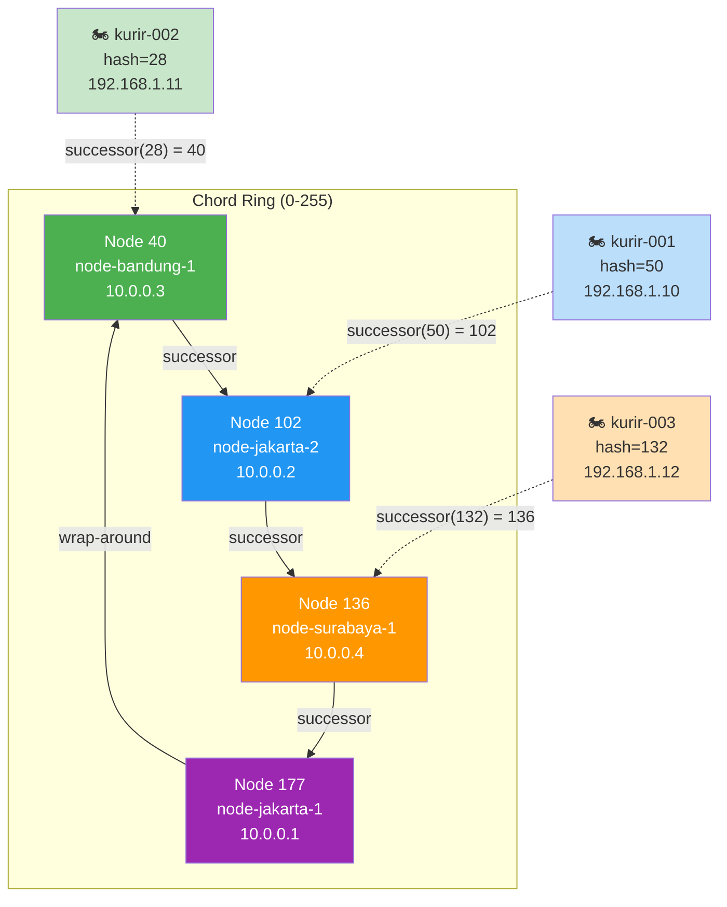
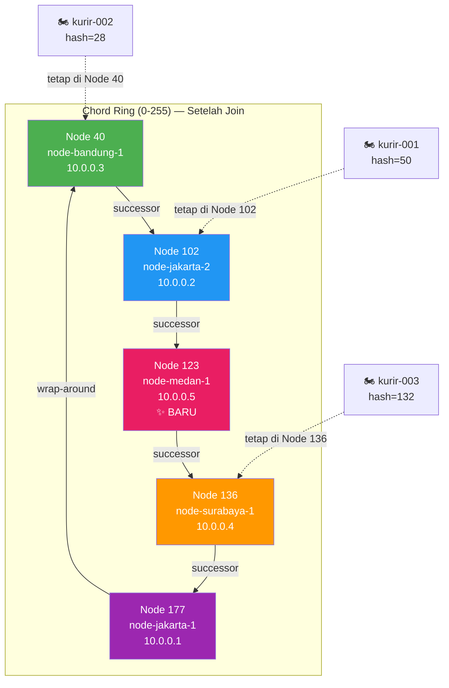
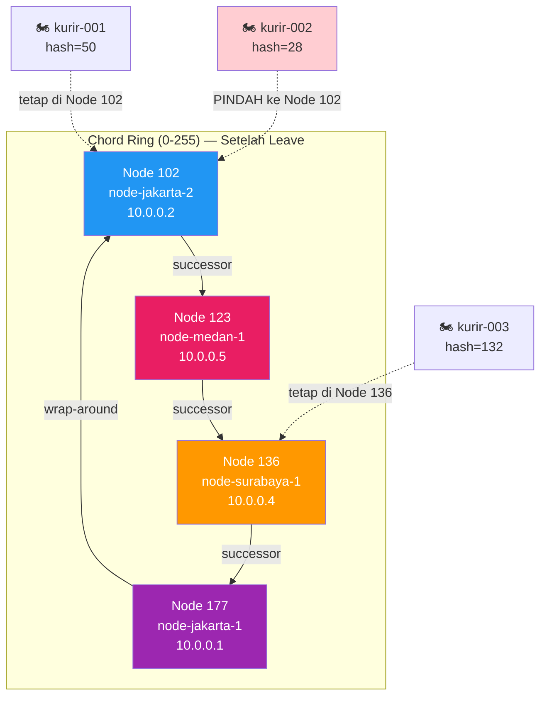

# Tugas 6 (Pekan 6) — Penamaan & Resolusi Lokasi

**Materi terkait:** Flat Naming, Structured Naming (DNS), Distributed Hash Table (DHT)/Chord.

## Studi Kasus

Pelanggan FoodGo kesulitan menemukan alamat IP server kurir yang **dinamis** (kurir berpindah lokasi/jaringan, IP-nya sering berubah). FoodGo butuh cara memetakan **ID Kurir** (identitas tetap) ke **alamat IP terkininya** tanpa server pusat tunggal yang jadi bottleneck/single point of failure.

## Tugas Kelompok

Implementasikan **simulasi Chord DHT** sederhana (single-process, tidak perlu jaringan sungguhan — cukup simulasi struktur data & algoritma di satu program Python) yang memetakan ID Kurir ke alamat IP mereka.

Konsep yang harus terlihat jalan dalam simulasi kalian:

1. **Consistent hashing**: ID Kurir dan ID Node di-hash ke ruang angka yang sama (mis. 0–255 untuk kesederhanaan, `m=8` bit).
2. **Ring topology**: node-node diurutkan melingkar berdasarkan hasil hash-nya.
3. **Lookup**: fungsi `lookup(kurir_id)` yang menemukan node mana yang bertanggung jawab menyimpan mapping ID Kurir tersebut → alamat IP-nya (aturan Chord: node dengan ID hash **terkecil yang lebih besar atau sama dengan** hash key, disebut _successor_).
4. **Perubahan topologi**: simulasikan minimal satu node baru bergabung (`join`) atau satu node keluar (`leave`), tunjukkan bagaimana mapping berpindah tanggung jawab ke node lain.

Skeleton disediakan di `src/chord_simulation.py` dengan fungsi hashing dan struktur ring sudah ada — bagian `lookup()`, `join()`, dan `leave()` sengaja dikosongkan.

### Cara Menjalankan

```bash
python3 src/chord_simulation.py
```

## Tugas Analisis (`README.md`)

1. Jelaskan **kenapa DHT/Chord** lebih cocok untuk kasus ini dibanding **flat naming sederhana** (mis. tabel pusat ID→IP) atau **DNS konvensional** — kaitkan dengan sifat "IP kurir sering berubah" dan kebutuhan tanpa titik gagal tunggal.
2. Gambarkan (boleh pakai Mermaid, lihat Tugas 2) ring topology dari simulasi kalian, tandai node mana yang bertanggung jawab atas ID Kurir mana.
3. Jelaskan apa yang terjadi pada mapping saat sebuah node **keluar** dari ring (siapa yang mengambil alih tanggung jawabnya) — dukung dengan output program.

## Struktur Submission

```
tugas-06-penamaan-dht/
├── README.md      # Analisis + diagram ring
├── JURNAL.md
├── src/
│   └── chord_simulation.py
└── bukti/          # Output program (screenshot/log) untuk skenario join & leave
```

## Rubrik Penilaian (Tugas 6)

| Komponen                               | Bobot | Kriteria                                                        |
| -------------------------------------- | ----- | --------------------------------------------------------------- |
| Implementasi lookup/join/leave benar   | 35%   | Consistent hashing & successor lookup sesuai aturan Chord       |
| Bukti perubahan topologi (join/leave)  | 25%   | Output menunjukkan mapping berpindah dengan benar               |
| Analisis kenapa DHT vs flat naming/DNS | 25%   | Argumen spesifik ke kasus IP kurir dinamis, bukan definisi umum |
| Proses & kontribusi kelompok           | 15%   | `JURNAL.md`, commit history                                     |

## Batasan Penggunaan AI (Level 2)

Kebijakan **Level 2 (AI Assisted Idea Generation & Structuring)** berlaku — lihat [`../RUBRIK-UMUM.md`](../RUBRIK-UMUM.md). Boleh bertanya konsep umum consistent hashing/Chord ke AI; **tidak boleh** meminta AI menuliskan isi `# TODO` di `src/chord_simulation.py` (`find_successor`, `join`, `leave`, dst). Catat pemakaian AI di "Log Penggunaan AI" pada `JURNAL.md`.

- `README.md` wajib menelusuri manual (langkah demi langkah) bagaimana `lookup()` menemukan successor untuk salah satu ID Kurir contoh yang dipakai di `chord_simulation.py` — bukan cuma menempelkan output program.

---

# Laporan Submission Kelompok 3 — Penamaan & Resolusi Lokasi (DHT/Chord)

**Kelompok:** Kelompok 3

| Nama                     | NIM          | Kontribusi                                                                                                                                                |
| ------------------------ | ------------ | --------------------------------------------------------------------------------------------------------------------------------------------------------- |
| Stefanus Andri Hendrawan | 103072400115 | Implementasi logika Chord DHT (`find_successor`, `join`, `leave`, `register_kurir`, `lookup`), pengujian skenario join & leave, dokumentasi bukti output. |
| Fatih Khairu Alfifajri   | 103072400105 | Analisis perbandingan DHT/Chord vs flat naming dan DNS konvensional, penelusuran manual proses lookup, dokumentasi `JURNAL.md`.                           |
| Moh Irham Maulana        | 103072400063 | Analisis skenario node keluar dan perpindahan tanggung jawab key, pembuatan diagram ring topology, validasi artefak bukti di `bukti/`.                    |

---

## 1. Analisis: Mengapa DHT/Chord Lebih Cocok Dibanding Flat Naming dan DNS Konvensional

### 1.1 Masalah Inti: IP Kurir yang Dinamis

Dalam studi kasus FoodGo, mitra kurir berpindah lokasi dan jaringan secara kontinu sepanjang beroperasi (dari Wi-Fi restoran ke jaringan seluler 4G/5G di jalan, lalu ke Wi-Fi pelanggan). Setiap perpindahan jaringan menyebabkan perubahan alamat IP perangkat kurir. Sistem FoodGo membutuhkan mekanisme **penamaan (naming)** yang dapat memetakan **ID Kurir** (identitas tetap) ke **alamat IP terkini** yang berubah-ubah tersebut.

### 1.2 Kelemahan Flat Naming (Tabel Pusat ID→IP)

Pendekatan flat naming sederhana menggunakan satu server pusat yang menyimpan tabel pemetaan `ID_Kurir → IP_Terkini`. Kelemahan pendekatan ini untuk kasus FoodGo:

1. **Single Point of Failure (SPOF):** Jika server pusat mati, seluruh sistem kehilangan kemampuan menemukan kurir manapun. Dalam konteks FoodGo yang beroperasi 24/7 dengan ribuan kurir aktif secara simultan, downtime sedetik saja berarti pesanan tidak dapat dialokasikan ke kurir.

2. **Bottleneck Performa:** Setiap kali IP kurir berubah (yang terjadi sangat sering — potensial puluhan ribu update per menit pada skala FoodGo nasional), server pusat harus menangani _write operation_ tersebut. Bersamaan, setiap _lookup_ dari sistem penugasan pesanan juga membebani server yang sama. Server pusat menjadi _hot spot_ yang membatasi skalabilitas.

3. **Tidak Toleran Terhadap Pertumbuhan:** Saat jumlah kurir bertambah dari ratusan ke puluhan ribu, satu server harus menangani seluruh beban tanpa mekanisme distribusi bawaan. Scaling hanya bisa dilakukan secara vertikal (hardware lebih kuat), bukan horizontal.

### 1.3 Kelemahan DNS Konvensional

DNS dirancang untuk memetakan nama domain (misalnya `kurir-001.foodgo.id`) ke alamat IP. Namun untuk kasus IP kurir yang sangat dinamis:

1. **TTL Caching Menghambat Pembaruan Real-Time:** DNS mengandalkan caching dengan Time-To-Live (TTL) untuk efisiensi. Jika TTL diset rendah (misal 30 detik) agar update IP cepat terpropagasi, beban query ke authoritative DNS server melonjak drastis karena cache resolver di seluruh jaringan terus kedaluwarsa. Jika TTL diset tinggi, resolver mengembalikan IP lama yang sudah tidak valid — kurir tidak bisa dihubungi.

2. **Tidak Dirancang untuk Update Frekuensi Tinggi:** Protokol DNS standard (RFC 2136 Dynamic DNS) memungkinkan update dinamis, namun arsitekturnya mengasumsikan perubahan jarang terjadi (server yang dipindah, bukan perangkat mobile yang berpindah jaringan tiap menit). Zone transfer dan propagasi hierarkis DNS tidak dirancang untuk volume update setinggi ini.

3. **Arsitektur Hierarkis dengan Root Server:** DNS memiliki titik-titik otoritas hierarkis. Meskipun redundan, arsitektur ini tetap memiliki komponen kritis yang jika gagal di level yang tepat, memutus resolusi nama untuk seluruh domain.

### 1.4 Keunggulan DHT/Chord untuk Kasus Ini

DHT (Distributed Hash Table) dengan protokol Chord menawarkan solusi yang mengatasi semua kelemahan di atas:

1. **Desentralisasi Penuh — Tanpa SPOF:** Tidak ada server pusat tunggal. Pemetaan `ID_Kurir → IP` didistribusikan secara merata ke seluruh node di ring. Jika satu node mati, hanya key yang dipegangnya yang perlu dipindahkan ke successor — node lain tetap beroperasi normal.

2. **Consistent Hashing — Update IP Efisien:** Ketika IP kurir berubah, cukup update satu entri di node penanggung jawab (successor dari hash key kurir). Tidak ada caching TTL yang harus dipropagasi ke seluruh jaringan. Perubahan bersifat _immediate_ — lookup berikutnya langsung mendapat IP terbaru.

3. **Skalabilitas Horizontal — Lookup $O(\log N)$:** Dengan memanfaatkan _finger table_, Chord menjamin lookup dalam $O(\log N)$ hop, di mana $N$ adalah jumlah node. Menambah node baru hanya memindahkan sebagian kecil key dari successor, tanpa mempengaruhi seluruh ring (_minimal disruption_).

4. **Toleransi Perubahan Topologi:** Node dapat bergabung (`join`) dan keluar (`leave`) kapan saja. Hanya key di rentang yang terdampak yang berpindah tanggung jawab — key lainnya tetap stabil di node yang sama. Ini ideal untuk infrastruktur FoodGo di mana server node bisa ditambah/dikurangi sesuai beban.

---

## 2. Diagram Ring Topology

### 2.1 Ring Setelah 4 Node Awal + 3 Kurir Teregistrasi

Hasil hash dari masing-masing entitas (menggunakan SHA-1 mod 256, `M_BITS = 8`):

| Entitas         | String              | Hash ID |
| --------------- | ------------------- | ------- |
| node-bandung-1  | `"node-bandung-1"`  | **40**  |
| node-jakarta-2  | `"node-jakarta-2"`  | **102** |
| node-surabaya-1 | `"node-surabaya-1"` | **136** |
| node-jakarta-1  | `"node-jakarta-1"`  | **177** |
| kurir-002       | `"kurir-002"`       | 28      |
| kurir-001       | `"kurir-001"`       | 50      |
| kurir-003       | `"kurir-003"`       | 132     |

Aturan penempatan key: key disimpan di **node dengan hash terkecil yang ≥ hash key** (successor). Jika tidak ada node dengan hash ≥ key, wrap-around ke node dengan hash terkecil.



Penjelasan penempatan:

- **kurir-002** (hash=28): Node terkecil yang ≥ 28 adalah Node **40** (node-bandung-1).
- **kurir-001** (hash=50): Node terkecil yang ≥ 50 adalah Node **102** (node-jakarta-2). Bukan Node 40, karena 40 < 50.
- **kurir-003** (hash=132): Node terkecil yang ≥ 132 adalah Node **136** (node-surabaya-1).

### 2.2 Ring Setelah Node Baru Bergabung (node-medan-1, id=123)



Node baru **node-medan-1** (hash=123) masuk di antara Node 102 dan Node 136. Karena tidak ada key dengan hash di rentang (102, 123], tidak ada key yang berpindah. Node-medan-1 akan menjadi penanggung jawab key-key baru yang hash-nya jatuh di rentang tersebut.

### 2.3 Ring Setelah Node Keluar (node-bandung-1, id=40)



Ketika Node 40 (node-bandung-1) keluar, **kurir-002** (hash=28) yang tadinya dipegang Node 40 berpindah ke Node **102** (node-jakarta-2) — karena Node 102 sekarang menjadi node terkecil yang ≥ 28 setelah Node 40 tidak ada. Namun karena 28 < 102, dan tidak ada node lain di bawah 102, wrap-around berlaku: Node 102 menjadi successor karena ia adalah node terkecil di ring sekarang.

---

## 3. Penelusuran Manual Proses Lookup — Contoh `kurir-001`

Berikut langkah-langkah detail bagaimana `lookup("kurir-001")` menemukan successor:

### Langkah 1: Hashing Key

```python
key_hash = hash_id("kurir-001")
# SHA-1("kurir-001") = b'...'
# int.from_bytes(digest, "big") % 256 = 50
```

`kurir-001` di-hash menjadi nilai **50** di ruang identifier 0–255.

### Langkah 2: Panggil `find_successor(50)`

Fungsi `find_successor` mencari node dengan hash **terkecil yang ≥ 50** di antara node aktif.

Daftar node aktif (terurut): `[40, 102, 136, 177]`

Iterasi pencarian:

1. Periksa Node **40**: 40 ≥ 50? → **Tidak** (40 < 50). Lanjut.
2. Periksa Node **102**: 102 ≥ 50? → **Ya!** ✅ Kembalikan **102**.

### Langkah 3: Ambil Data dari `self.data`

```python
# key_hash = 50 ada di self.data → ("kurir-001", "192.168.1.10")
# Node penanggung jawab = Node 102 (node-jakarta-2, 10.0.0.2)
# Kembalikan IP kurir: "192.168.1.10"
```

### Langkah 4: Hasil

```
kurir-001 (hash=50) → ditemukan di Node 102 (10.0.0.2), IP: 192.168.1.10
```

### Contoh Wrap-Around: `kurir-002` Setelah Node 40 Keluar

Setelah node-bandung-1 (Node 40) keluar, daftar node aktif: `[102, 123, 136, 177]`.

```
key_hash = hash_id("kurir-002") = 28
```

Iterasi `find_successor(28)`:

1. Periksa Node **102**: 102 ≥ 28? → **Ya!** ✅ Kembalikan **102**.

Meskipun 28 jauh di bawah 102, Node 102 tetap menjadi successor karena ia adalah node terkecil yang masih ≥ 28 (setelah Node 40 tidak ada lagi di ring).

---

## 4. Analisis Skenario Node Keluar: Siapa Mengambil Alih?

### 4.1 Keadaan Sebelum Node Keluar

Dengan 5 node aktif (`[40, 102, 123, 136, 177]`), pembagian tanggung jawab:

| Key       | Hash | Successor (Node Penanggung Jawab)    |
| --------- | ---- | ------------------------------------ |
| kurir-002 | 28   | Node 40 (node-bandung-1, 10.0.0.3)   |
| kurir-001 | 50   | Node 102 (node-jakarta-2, 10.0.0.2)  |
| kurir-003 | 132  | Node 136 (node-surabaya-1, 10.0.0.4) |

### 4.2 Saat Node 40 (node-bandung-1) Keluar

Ketika `leave("node-bandung-1")` dipanggil:

1. Node 40 dihapus dari ring. Node aktif menjadi: `[102, 123, 136, 177]`.
2. Untuk setiap key yang tadinya dipegang Node 40, dicari successor baru:
   - **kurir-002** (hash=28): `find_successor(28)` pada ring `[102, 123, 136, 177]`:
     - 102 ≥ 28? → Ya → Successor baru = **Node 102 (node-jakarta-2)**
   - Key ini **berpindah** dari Node 40 → Node 102.
3. Key lain yang **tidak** dipegang Node 40 tetap di tempatnya:
   - **kurir-001** (hash=50): successor tetap Node 102 ✅
   - **kurir-003** (hash=132): successor tetap Node 136 ✅

### 4.3 Output Program yang Mendukung Analisis

```
[LEAVE] Node 'node-bandung-1' (id=40, ip=10.0.0.3) keluar dari ring
  -> Key 'kurir-001' (hash=50) sekarang tanggung jawab Node 102 (10.0.0.2)
  -> Key 'kurir-002' (hash=28) sekarang tanggung jawab Node 102 (10.0.0.2)
  -> Key 'kurir-003' (hash=132) sekarang tanggung jawab Node 136 (10.0.0.4)
```

Perhatikan bahwa **kurir-002** berpindah ke Node 102, sementara kurir-001 dan kurir-003 tidak terpengaruh. Ini mendemonstrasikan properti inti _consistent hashing_: **hanya key di rentang node yang terdampak yang perlu dipindahkan**, sementara key lainnya tetap stabil.

### 4.4 Verifikasi Lookup Setelah Leave

```
kurir-001 -> 192.168.1.10   ← tetap ditemukan (Node 102)
kurir-002 -> 192.168.1.11   ← tetap ditemukan (sekarang di Node 102, sebelumnya Node 40)
kurir-003 -> 192.168.1.12   ← tetap ditemukan (Node 136)
```

Semua lookup tetap berhasil — tidak ada data yang hilang meskipun satu node telah keluar dari ring. Inilah ketahanan (_resilience_) yang ditawarkan DHT/Chord.

---

## 5. Bukti Eksekusi

Seluruh output simulasi telah disimpan sebagai log teks di [`bukti/output-simulasi.txt`](bukti/output-simulasi.txt). Output mencakup keempat skenario: join 4 node awal, registrasi 3 kurir, join node baru, dan leave node.
