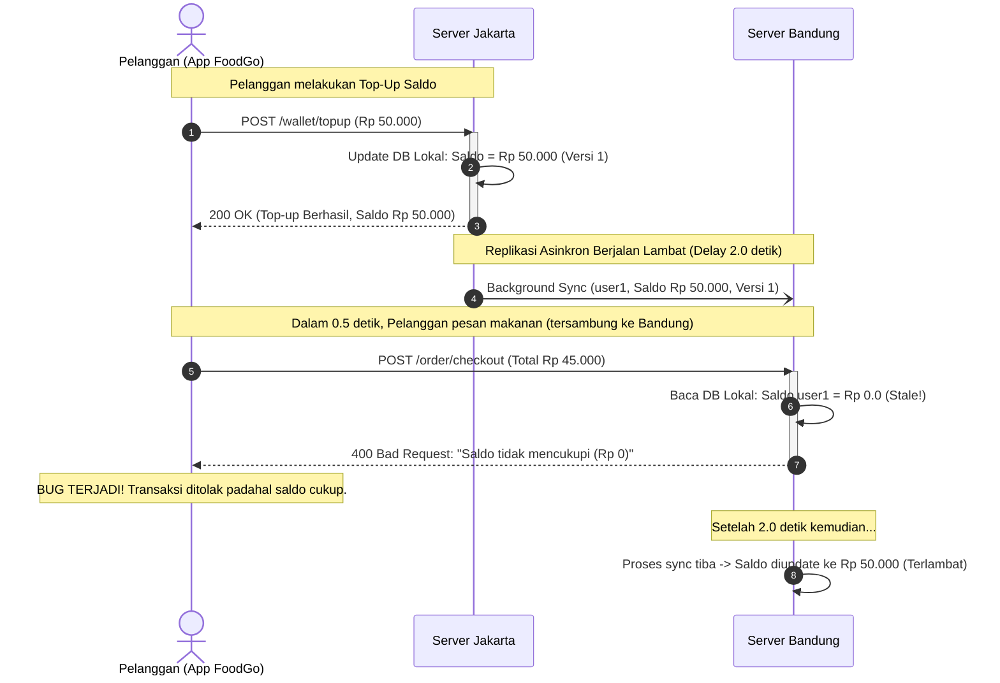
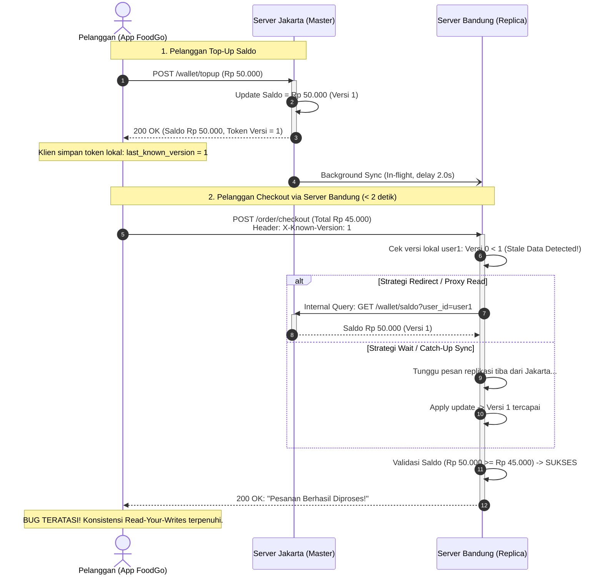

# Tugas 7 (Pekan 7) — Konsistensi Data

**Materi terkait:** Data-Centric Consistency (Sequential, Eventual), Client-Centric Consistency.

## Studi Kasus

Data saldo *e-wallet* pelanggan FoodGo berbeda antara server wilayah **Jakarta** dan **Bandung** karena replikasi antar server berjalan lambat. Contoh kasus nyata: pelanggan top-up saldo lewat server Jakarta, lalu dalam hitungan detik memesan makanan lewat aplikasi yang tersambung ke server Bandung — saldo belum ter-update, transaksi ditolak padahal saldo sebenarnya cukup.

## Tugas Kelompok

### Bagian 1 — Analisis (wajib)

1. Tentukan: apakah kasus ini **membutuhkan Sequential Consistency** (semua replika melihat urutan operasi yang sama) atau **cukup Eventual Consistency** (replika akan konsisten "pada akhirnya", boleh sementara berbeda)? Berikan argumen berbasis dampak bisnis (mis. kasus saldo *e-wallet* jauh lebih sensitif dibanding kasus "jumlah like" di media sosial).
2. Jika kalian menyimpulkan Eventual Consistency saja **tidak cukup** untuk skenario ini, usulkan pendekatan **Client-Centric Consistency** yang relevan (mis. *Read-Your-Writes*: pelanggan yang baru top-up harus selalu melihat saldo terbarunya sendiri, walau replika lain belum sinkron).
3. Gambarkan **diagram alir urutan (sequence diagram)** yang menunjukkan operasi read/write antara pelanggan, server Jakarta, server Bandung, dan proses replikasi — untuk skenario **tanpa** jaminan konsistensi (bug terjadi) DAN skenario **dengan** solusi yang kalian usulkan (bug teratasi). Pakai Mermaid (`sequenceDiagram`) di `README.md` — lihat contoh cara pakai di Tugas 2.

### Bagian 2 — Simulasi (opsional, nilai tambah)

Skeleton `src/replica_simulation.py` mensimulasikan dua replika (Jakarta & Bandung) dengan delay replikasi buatan. Lengkapi TODO untuk:
1. Menunjukkan kondisi **inconsistent read** (replika Bandung masih menunjukkan saldo lama walau Jakarta sudah update).
2. Mengimplementasikan mekanisme **Read-Your-Writes** sederhana (mis. dengan version/timestamp per client) yang memperbaiki masalah tersebut.

```bash
python3 src/replica_simulation.py
```

## Struktur Submission

```
tugas-07-konsistensi-data/
├── README.md      # Analisis konsistensi + sequence diagram Mermaid
├── JURNAL.md
├── src/            # (opsional) simulasi replikasi
└── bukti/          # (jika mengerjakan simulasi) output program
```

## Rubrik Penilaian (Tugas 7)

| Komponen | Bobot | Kriteria |
|---|---|---|
| Ketepatan pemilihan model konsistensi | 30% | Argumen berbasis dampak bisnis nyata, bukan hafalan definisi |
| Kualitas sequence diagram | 30% | Menunjukkan jelas titik kegagalan & titik perbaikan |
| Usulan solusi client-centric | 25% | Solusi konkret dan dapat diimplementasikan (bukan wacana abstrak) |
| Proses & kontribusi kelompok | 15% | `JURNAL.md`, commit history (+ bonus jika simulasi dikerjakan) |

## Batasan Penggunaan AI (Level 2)

Kebijakan **Level 2 (AI Assisted Idea Generation & Structuring)** berlaku — lihat [`../RUBRIK-UMUM.md`](../RUBRIK-UMUM.md). Boleh bertanya konsep umum consistency model ke AI untuk brainstorming; **tidak boleh** meminta AI menuliskan analisis akhir/sequence diagram atau isi `# TODO` di `src/replica_simulation.py` yang tinggal ditempel. Catat pemakaian AI di "Log Penggunaan AI" pada `JURNAL.md`.

- Sebagai bukti pemahaman konsep (bukan hafalan jawaban skenario FoodGo saja), `README.md` wajib menyertakan **satu skenario tambahan** yang kalian buat sendiri (mis. kasus lain di aplikasi ojek online) dan menentukan model konsistensi yang tepat untuk skenario tambahan tersebut.

---

# Laporan Submission Kelompok 3 — Konsistensi Data Terdistribusi

**Kelompok:** Kelompok 3  

| Nama | NIM | Kontribusi |
|---|---|---|
| Stefanus Andri Hendrawan | 103072400115 | Implementasi simulasi replikasi (`src/replica_simulation.py`: TODO 1–3), pengujian skenario Naif vs Read-Your-Writes, dan dokumentasi bukti pengujian di `bukti/`. |
| Fatih Khairu Alfifajri | 103072400105 | Analisis model konsistensi (Eventual vs Sequential vs Client-Centric), argumentasi dampak bisnis saldo e-wallet, dan dokumentasi `JURNAL.md`. |
| Moh Irham Maulana A.S | 103072400063 | Perancangan sequence diagram Mermaid (skenario bug vs solusi RYW), formulasi arsitektur metadata versioning, dan analisis skenario tambahan ojek online. |

---

## 1. Analisis Model Konsistensi pada Kasus Saldo E-Wallet FoodGo

### 1.1 Apakah Cukup Menggunakan Eventual Consistency?
**Kesimpulan:** **Eventual Consistency TIDAK CUKUP** untuk skenario saldo *e-wallet* FoodGo.

#### Argumentasi Berbasis Dampak Bisnis Nyata:
1. **Kegagalan Transaksi Palsu (*False Negative Insufficient Funds*):**
   - Pada model Eventual Consistency, replika hanya dijamin konvergen "pada akhirnya" tanpa batasan waktu (*unbounded delay*).
   - Ketika pelanggan melakukan top-up sebesar Rp 50.000 di Jakarta, lalu berpindah jaringan atau diarahkan oleh load balancer ke server Bandung dalam hitungan detik untuk memesan makanan senilai Rp 45.000, server Bandung masih melihat saldo lama (Rp 0).
   - Akibatnya transaksi pemesanan ditolak dengan pesan *"Saldo Anda tidak mencukupi"*. Pelanggan mengalami frustrasi berat karena uang tunai/rekening bank mereka telah terdebit, namun hak layanan di aplikasi tidak dapat digunakan.

2. **Dampak Finansial Langsung dan Erosi Kepercayaan:**
   - **Kerugian Nilai Transaksi (Gross Merchandise Value / GMV):** Pelanggan yang pesanannya gagal cenderung membatalkan pesanan atau berpindah ke platform kompetitor. Restoran mitra dan kurir kehilangan potensi pendapatan.
   - **Peningkatan Beban Operasional Dukungan Pelanggan (Customer Support Spike):** Ketidaksinkronan saldo langsung memicu kepanikan pengguna yang mengira dana mereka hilang, mengakibatkan lonjakan tiket komplain/chat CS yang membebani biaya operasional.
   - **Risiko Eksploitasi Pembelanjaan Ganda (*Double Spending*):** Pada skenario replikasi multimaster/asinkron tanpa proteksi, jika pelanggan memiliki saldo Rp 50.000 dan secara simultan membelanjakannya di dua server terpisah sebelum replikasi terjadi, kedua transaksi bisa lolos, mengakibatkan kerugian finansial langsung bagi FoodGo (*financial deficit*).

3. **Perbandingan dengan Metrik "Jumlah Like" di Media Sosial:**
   - **Jumlah Like:** Bersifat *tolerant to inconsistency*. Jika seorang pengguna menyukai postingan dan penghitung like di server lain terlambat bertambah dari 1.020 menjadi 1.021 selama beberapa detik atau menit, tidak ada kerugian finansial, tidak ada alur transaksi yang terputus, dan pengalaman pengguna secara umum tidak terganggu (operasi penambahan like bersifat monotonik dan komutatif).
   - **Saldo E-Wallet:** Merupakan instrumen moneter legal (*financial asset*). Setiap operasi debit/kredit memiliki relasi kausalitas (*causal dependency*) yang ketat dengan otorisasi transaksi. Pengguna menuntut konsistensi absolut atas tindakan finansial yang baru saja mereka lakukan.

---

### 1.2 Apakah Wajib Menggunakan Sequential Consistency?
- **Sequential Consistency (Data-Centric)** mensyaratkan bahwa seluruh replika harus melihat semua operasi write dan read dalam urutan global yang sama, dan operasi tiap proses dieksekusi sesuai urutan programnya.
- **Kelemahan jika diterapkan penuh secara global:**
  - Berdasarkan **Teorema CAP** dan **PACELC**, memaksakan Sequential Consistency pada sistem terdistribusi multi-region (Jakarta - Bandung) mengharuskan replikasi sinkron (*synchronous coordination*, misal via Raft/2PC) pada setiap operasi penulisan.
  - Hal ini menyebabkan latensi tulis (*write latency*) melonjak drastis karena harus menunggu round-trip jaringan antar-kota (*WAN network latency*). Jika link jaringan Jakarta–Bandung mengalami degradasi atau *partition*, sistem tidak dapat memproses top-up (*unavailability*).

---

### 1.3 Solusi Terbaik: Pendekatan Client-Centric Consistency (Read-Your-Writes)
Karena memaksakan Sequential Consistency global terlalu mahal dari sisi latensi dan ketersediaan, sedangkan Eventual Consistency murni merusak integritas bisnis, solusi arsitektur yang paling tepat dan pragmatis adalah **Client-Centric Consistency**, khususnya model **Read-Your-Writes (RYW)**.

- **Definisi Read-Your-Writes:**
  > *"Efek dari operasi penulisan yang dilakukan oleh suatu klien $C$ pada item data $x$ akan selalu langsung terlihat pada operasi pembacaan berikutnya terhadap $x$ oleh klien $C$ yang sama."*

- **Mengapa Sangat Tepat untuk Kasus FoodGo?**
  - Pengguna lain tidak perlu melihat saldo pengguna $A$ secara seketika (karena saldo $A$ adalah data privat milik $A$).
  - Yang terpenting adalah **pengguna $A$ sendiri** tidak boleh melihat data *stale* dari akunnya sendiri setelah melakukan top-up.
  - Pendekatan ini memungkinkan sistem tetap menggunakan replikasi asinkron antar-region yang hemat bandwidth dan berlatensi rendah, sementara integritas pembacaan per pelanggan dijamin penuh melalui propagasi metadata versi (misalnya via *version token* atau *client-session state*).

---

## 2. Arsitektur dan Mekanisme Read-Your-Writes

Untuk mengimplementasikan Read-Your-Writes pada sistem FoodGo, digunakan mekanisme **Client-Assisted Version Tracking**:

```
[ Klien / App Mobile ]
   │
   ├── (1) TOP-UP Rp 50.000 ───────────► [ Server Jakarta (Master) ]
   │                                           │ (Write lokal sukses: Versi 1)
   │◄── (2) Response: OK, Version=1 ───────────┘
   │
   │   [Klien simpan: known_version = 1]
   │
   └── (3) PESAN MAKANAN (Cek Saldo) ──► [ Server Bandung ]
           Header: X-Known-Version: 1          │
                                               ├─ Evaluasi: Versi lokal Bandung masih 0 < 1!
                                               │  (Terdeteksi Stale Data)
                                               │
                                               ├─ Solusi A: Meredirect / Fetch ke Server Jakarta
                                               │  ATAU
                                               └─ Solusi B: Tunggu (catch-up) replikasi sinkron
```

### Strategi Eksekusi Saat Replika Lokal Stale:
1. **Master / Replica-of-Origin Redirect (Fast Fallback):**
   Ketika server Bandung melihat bahwa nomor versi lokal untuk `user_id` lebih kecil dari versi yang dibawa klien (`versi_lokal < versi_klien`), server Bandung langsung mengalihkan (*forward/proxy*) pembacaan saldo ke server Jakarta yang memegang versi terbaru. Klien langsung mendapatkan saldo Rp 50.000 tanpa *delay*.
2. **Sync-on-Demand (Wait & Poll):**
   Jika server Bandung ingin menyajikan data sendiri tanpa redirect, koneksi pembacaan ditahan sesaat (*polling*) hingga replikasi asinkron dari Jakarta tiba. Begitu versi lokal $\ge$ versi klien, nilai saldo dikembalikan.
3. **Session Affinity / Sticky Routing:**
   Load balancer mengarahkan trafik pengguna ke server yang sama selama durasi perkiraan latensi replikasi (misal 5 detik setelah write), sebelum membebaskan routing kembali.

---

## 3. Sequence Diagram (Mermaid)

### 3.1 Skenario Tanpa Jaminan Konsistensi (Bug Terjadi)
Diagram berikut menggambarkan kondisi replikasi asinkron naif tanpa jaminan *Read-Your-Writes*. Pelanggan mengalami penolakan transaksi karena server Bandung menyajikan data *stale*:



---

### 3.2 Skenario Dengan Solusi Read-Your-Writes (Bug Teratasi)
Diagram berikut menggambarkan sistem yang menerapkan mekanisme **Read-Your-Writes** menggunakan token versi transaksi klien dan pengalihan dinamis (*smart fallback/redirect*):



---

## 4. Skenario Tambahan (Studi Kasus Mandiri)

Sebagai pembuktian pemahaman model konsistensi secara komprehensif, berikut adalah perancangan skenario tambahan di luar sistem e-wallet FoodGo:

### 4.1 Kasus A: Fitur "Klaim Flash Voucher Diskon 90% (Kuota Terbatas 50 Pemenang)"
- **Deskripsi Kasus:**
  FoodGo mengadakan promo kilat (*flash sale*) pukul 12.00 WIB di mana hanya tersedia 50 kupon diskon makanan 90%. Ratusan ribu pengguna di Jakarta, Bandung, dan Surabaya menekan tombol klaim voucher pada milidetik yang sama.
- **Model Konsistensi yang Tepat:** **Strict / Sequential Consistency** (didukung oleh *Distributed Locking / Distributed Mutex* atau *Single Raft Leader Order*).
- **Alasan Pemilihan Model:**
  - Jika menggunakan Eventual Consistency, replika Jakarta, Bandung, dan Surabaya akan memvalidasi sisa kuota secara independen. Masing-masing server dapat melihat sisa kuota masih 1, lalu mengonfirmasi klaim ke puluhan pengguna berbeda secara serentak.
  - Hal ini menyebabkan fenomena **Over-claiming / Race Condition** (misal 50 kupon terklaim oleh 250 orang).
  - Dampak finansial ke FoodGo sangat destruktif karena perusahaan harus menanggung subsidi diskon yang membengkak ratusan juta rupiah. Oleh karena itu, operasi klaim voucher wajib diurutkan secara total (*total order*) dan atomik melalui replikasi konsisten berbasis kuorum/leader.

---

### 4.2 Kasus B: Fitur "Live Tracking Posisi GPS Kurir pada Peta Pelanggan"
- **Deskripsi Kasus:**
  Ketika kurir sedang mengantarkan pesanan, perangkat kurir mengirimkan koordinat GPS setiap 2 detik ke server. Aplikasi pelanggan menampilkan ikon sepeda motor kurir yang bergerak di atas peta secara real-time. Pelanggan terhubung ke beberapa replika edge/gateway karena mobilitas seluler.
- **Model Konsistensi yang Tepat:** **Monotonic Reads (Client-Centric Consistency)**.
- **Alasan Pemilihan Model:**
  - Koordinasi Sequential Consistency global sangat tidak efisien dan menyebabkan peta menjadi patah-patah (*high latency lag*).
  - Namun, Eventual Consistency murni tanpa kontrol klien akan menyebabkan bug visual yang aneh: jika permintaan pelacakan ke-1 dilayani oleh replika yang memiliki data GPS pukul `12:01:04`, lalu permintaan pelacakan ke-2 diarahkan ke replika satelit lain yang replikasinya tertinggal (memiliki data GPS pukul `12:01:00`), maka ikon kurir di layar pelanggan akan **melompat mundur ke belakang** (*time-travel backward*).
  - Dengan jaminan **Monotonic Reads**, jika klien telah menerima koordinat dengan timestamp $t_1$, klien menolak koordinat manapun yang memiliki timestamp $t < t_1$. Hal ini menjamin pergerakan kurir di peta selalu bergerak maju (*monotonically forward*) secara mulus tanpa memerlukan sinkronisasi database global yang berat.

---

## 5. Implementasi & Bukti Simulasi (`src/replica_simulation.py`)

Bagian simulasi opsional diimplementasikan pada `src/replica_simulation.py` untuk membuktikan teori di atas:
1. **TODO 1:** Menggunakan `threading.Timer(REPLICATION_DELAY, ...)` untuk mensimulasikan latensi transmisi replikasi antar-kota sebesar 2.0 detik.
2. **TODO 2:** Mengimplementasikan fungsi `baca_saldo_read_your_writes()` dengan membandingkan versi data lokal terhadap versi yang diketahui klien (`versi_minimal`). Menyediakan dua strategi resolusi data: *redirect* ke master dan *wait/poll* hingga sinkronisasi selesai.
3. **TODO 3:** Memanggil mekanisme *Read-Your-Writes* pada skenario pemesanan makanan segera setelah top-up ($t = 0.5\text{ detik} < 2.0\text{ detik}$).

### Bukti Eksekusi Terminal (Tersimpan di `bukti/output_simulasi.txt`):
```text
================================================================
=== Skenario 1: Pembacaan NAIF (Tanpa Read-Your-Writes) ===
================================================================
[*] Pelanggan 'user1' melakukan TOP-UP sebesar Rp 50.000 ke Server Jakarta...
[Jakarta] WRITE saldo user1 = 50000.0 (versi 1)
[REPLIKASI] Memulai proses replikasi asinkron ke server Bandung (delay 2.0 detik)...

[*] Pelanggan langsung memesan makanan via Server Bandung setelah 0.5 detik...
[*] Hasil baca saldo dari Bandung (naif): Rp 0.0
[-] HASIL: Harusnya Rp 50.000, tapi karena delay replikasi, terbaca Rp 0.0 (BUG / Inconsistent Read!)
[-] DAMPAK: Transaksi pesanan makanan DITOLAK karena saldo dianggap tidak mencukupi.

[*] Menunggu sinkronisasi replikasi selesai (2.0 detik)...
[Bandung] WRITE saldo user1 = 50000.0 (versi 1)
[*] Saldo di Bandung setelah replikasi selesai: Rp 50000.0 (Eventual Consistency tercapai)

================================================================
=== Skenario 2: Pembacaan dengan READ-YOUR-WRITES (Solusi) ===
================================================================
[*] Pelanggan 'user1' melakukan TOP-UP tambahan sebesar Rp 20.000 ke Server Jakarta...
[Jakarta] WRITE saldo user1 = 70000.0 (versi 2)
[REPLIKASI] Memulai proses replikasi asinkron ke server Bandung (delay 2.0 detik)...
[*] Token / Context Klien menyimpan metadata versi transaksi terakhir: Versi 2

[*] Uji Kasus A (Pendekatan Redirect):
[*] Pelanggan mengakses Server Bandung setelah 0.5 detik membawa token Versi 2...
[RYW Guard] Server Bandung versi data=1 < versi minimal klien=2 (DATA STALE/KEDALUWARSA)!
[RYW Guard] -> Tindakan: Meredirect pembacaan ke server Jakarta (Master / Up-to-date)...
[+] Hasil saldo terbaca (Read-Your-Writes - Redirect): Rp 70000.0
[+] STATUS: SUKSES! Saldo terbaca mutakhir (Rp 70.000). Transaksi pesanan berhasil diproses!

[*] Uji Kasus B (Pendekatan Wait / Sync-on-Demand):
[*] Mensimulasikan klien yang bersedia menunggu sinkronisasi selesai:
[RYW Guard] Server Bandung versi data=1 < versi minimal klien=2 (DATA STALE/KEDALUWARSA)!
[RYW Guard] -> Tindakan: Menunggu (polling) replika Bandung hingga tersinkronisasi...
[Bandung] WRITE saldo user1 = 70000.0 (versi 2)
[RYW Guard] -> Server Bandung selesai tersinkronisasi ke versi 2.
[+] Hasil saldo terbaca (Read-Your-Writes - Wait): Rp 70000.0
[+] STATUS: SUKSES! Server Bandung berhasil menyajikan saldo yang konsisten setelah replikasi tiba.
```

### Kesimpulan Pengujian:
- Pada Skenario Naif, *window of inconsistency* selama 2 detik menyebabkan pembacaan pada detik ke-0.5 menghasilkan saldo Rp 0.0, memicu penolakan transaksi.
- Pada Skenario Read-Your-Writes, deteksi versi secara proaktif mengenali bahwa replika Bandung belum *up-to-date*. Melalui pengalihan (*redirect*) ke Jakarta atau penungguan (*wait*), saldo Rp 70.000 selalu berhasil disajikan secara benar kepada klien, mengeliminasi kegagalan transaksi.
