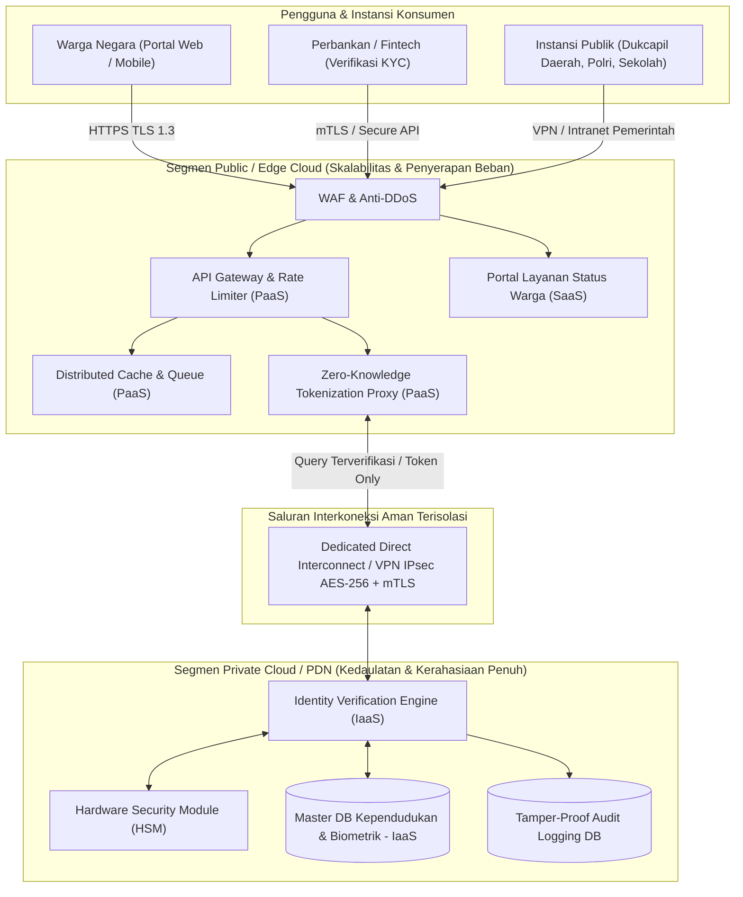

# Tugas 9 (Pekan 9) — Cloud Delivery & Deployment Model

**Materi terkait:** Karakteristik esensial cloud computing (NIST SP 800-145), Deployment Model (Public/Private/Hybrid/Community), Service Model (IaaS/PaaS/SaaS).

> Bagian 2 mata kuliah ini murni **analisis & desain di atas kertas** — tidak ada biaya cloud sama sekali, karena tugas berhenti di tahap rekomendasi, bukan implementasi nyata (implementasi baru mulai Tugas 11).

## Studi Kasus

Pemerintah ingin membangun **Sistem Data Kependudukan** (nama, NIK, alamat, data biometrik) yang:
- Sangat **rahasia** (data pribadi warga negara, diatur UU Perlindungan Data Pribadi).
- Diakses oleh **ribuan instansi** (dukcapil daerah, kepolisian, bank untuk verifikasi KYC) dengan pola akses yang **tidak rata** (lonjakan saat musim pemilu/pendaftaran sekolah).
- Butuh **skalabilitas** agar tidak downtime saat lonjakan akses, tapi **tidak boleh** datanya berada di infrastruktur yang tidak terkendali penuh oleh negara.

## Tugas Kelompok

1. **Rekomendasikan Deployment Model** (Public / Private / Hybrid / Community Cloud) yang paling tepat untuk sistem ini. Jelaskan alasannya berdasarkan **karakteristik NIST** (on-demand self-service, broad network access, resource pooling, rapid elasticity, measured service) dikaitkan dengan kebutuhan kerahasiaan vs skalabilitas.
2. **Rekomendasikan Service Model** (IaaS / PaaS / SaaS) yang tepat untuk komponen-komponen berbeda dari sistem ini (boleh berbeda service model untuk komponen berbeda, mis. database inti vs portal publik untuk pengecekan status).
3. Jelaskan **minimal 2 risiko spesifik** dari pilihan kalian dan mitigasinya (mis. jika Hybrid Cloud dipilih: risiko sinkronisasi data antara private & public segment).
4. Bandingkan singkat dengan **satu alternatif yang kalian tolak** — kenapa alternatif itu kurang tepat (mis. kenapa Public Cloud murni ditolak, atau kenapa Private Cloud murni dianggap kurang skalabel).

## Struktur Submission

```
tugas-09-cloud-delivery-deployment/
├── README.md      # Analisis lengkap (isi dengan poin 1-4 di atas)
├── JURNAL.md
└── bukti/          # (opsional) diagram pendukung
```

## Rubrik Penilaian (Tugas 9)

| Komponen | Bobot | Kriteria |
|---|---|---|
| Ketepatan rekomendasi deployment model | 30% | Argumen berbasis karakteristik NIST, bukan sekadar "private cloud lebih aman" tanpa detail |
| Ketepatan rekomendasi service model | 25% | Pemetaan komponen sistem ke IaaS/PaaS/SaaS masuk akal |
| Analisis risiko & mitigasi | 25% | Risiko spesifik ke konteks data kependudukan (bukan risiko generik) |
| Perbandingan dengan alternatif yang ditolak | 20% | Argumen penolakan jelas dan berdasar |

## Batasan Penggunaan AI (Level 2)

Kebijakan **Level 2 (AI Assisted Idea Generation & Structuring)** berlaku — lihat [`../RUBRIK-UMUM.md`](../RUBRIK-UMUM.md). Boleh bertanya ke AI gambaran umum karakteristik NIST/deployment model untuk brainstorming; **tidak boleh** meminta AI menuliskan rekomendasi/analisis akhir yang tinggal ditempel ke `README.md`. Catat pemakaian AI di "Log Penggunaan AI" pada `JURNAL.md`.

- Jawaban yang terasa seperti "template" (bisa dipakai untuk sistem cloud apa saja tanpa menyebut spesifik kependudukan/data pribadi/regulasi) akan dinilai rendah pada komponen ketepatan rekomendasi.
- `README.md` wajib membahas minimal satu skenario tandingan yang kalian buat sendiri (mis. "bagaimana jika instansi daerah tidak punya infrastruktur private cloud sendiri?") beserta jawabannya.

---

# Laporan Submission Kelompok 3 — Cloud Delivery & Deployment Model

**Kelompok:** Kelompok 3  

| Nama | NIM | Kontribusi |
|---|---|---|
| Stefanus Andri Hendrawan | 103072400115 | Analisis dan rekomendasi deployment model (Hybrid Cloud) berbasis 5 karakteristik esensial NIST SP 800-145, perancangan diagram arsitektur cloud terintegrasi, dan penyusunan mitigasi risiko infrastruktur. |
| Fatih Khairu Alfifajri | 103072400105 | Analisis pemetaan service model (IaaS, PaaS, SaaS) untuk tiap komponen sistem data kependudukan, perbandingan komprehensif dengan alternatif yang ditolak (Public & Private murni), dan dokumentasi `JURNAL.md`. |
| Moh Irham Maulana A.S | 103072400063 | Evaluasi risiko spesifik kepatuhan UU PDP & kebocoran data lintas segmen, perumusan solusi mitigasi teknis (tokenization & mTLS), perancangan skenario tandingan instansi daerah pelosok (Hub-and-Spoke SaaS), dan finalisasi laporan. |

---

## 1. Rekomendasi Deployment Model: Hybrid Cloud (Sovereign Hybrid Cloud)

Untuk memenuhi dualitas kebutuhan yang tampak bertolak belakang—yaitu **kerahasiaan tingkat tinggi (*strict data confidentiality*)** yang diwajibkan oleh regulasi negara dan **skalabilitas masif tak terduga (*extreme scalability & elasticity*)** akibat pola akses ribuan instansi—rekomendasi deployment model yang paling tepat adalah **Hybrid Cloud (Sovereign Hybrid Cloud)**.

Dalam model ini, sistem dibagi secara tegas menjadi dua segmen:
1. **Segmen Private Cloud (Pusat Data Nasional / Sovereign Gov-Cloud):** Mengisolasi *Master Database* kependudukan, data biometrik (sidik jari, iris, pengenalan wajah), modul enkripsi *Hardware Security Module* (HSM), serta mesin verifikasi identitas inti di bawah kendali administratif dan fisik mutlak pemerintah Republik Indonesia (Kementerian Kominfo, Ditjen Dukcapil, dan BSSN).
2. **Segmen Public / Government-Accredited Cloud (Edge & Verification Layer):** Meng-host *API Gateway, Tokenization & Zero-Knowledge Verification Service, Caching Layer*, serta portal informasi publik yang bertugas menyerap lonjakan trafik (*cloud bursting*) dari ribuan instansi mitra (bank, fintech, kepolisian, sekolah).



### Analisis Berdasarkan 5 Karakteristik Esensial NIST SP 800-145:

| Karakteristik Esensial NIST | Penerapan pada Kasus Data Kependudukan | Keseimbangan Kerahasiaan vs Skalabilitas |
|---|---|---|
| **1. On-Demand Self-Service** | Ribuan instansi mitra (mis. 120+ bank umum untuk KYC, 500+ dinas dukcapil, ribuan panitia PPDB) dapat melakukan registrasi, mengelola kunci API (*API Keys / OAuth2 Credentials*), dan memantau kuota transaksi verifikasi secara mandiri melalui portal pengembang (*developer portal*) tanpa memerlukan intervensi manual dari staf IT pusat untuk setiap permohonan akses harian. | **Kerahasiaan Terjaga:** Hak akses dibatasi melalui prinsip *Least Privilege* dan *Role-Based Access Control* (RBAC) ketat berbasis token kriptografis berumur pendek (*ephemeral JWT*). |
| **2. Broad Network Access** | Layanan verifikasi dapat diakses dari berbagai lokasi dan perangkat: jaringan tertutup Intranet Pemerintah (Palapa Ring) untuk dinas daerah, koneksi leased-line/VPN untuk perbankan, hingga web browser standar bagi masyarakat umum melalui protokol aman standar industri (HTTPS TLS 1.3, mTLS, RESTful API, gRPC). | **Kerahasiaan Terjaga:** Semua kanal komunikasi dienkripsi penuh *in-transit*. Data sensitif biometrik tidak pernah dibuka ke jaringan terbuka, hanya status boolean (*Valid / Not Valid*) atau token terotentikasi yang ditransmisikan. |
| **3. Resource Pooling** | Sumber daya komputasi (*CPU, memory, storage, bandwidth*) pada klaster kontainer dikumpulkan secara dinamis (*multi-tenant*) untuk melayani beban kueri verifikasi dari ratusan instansi sekaligus dengan isolasi virtual (*network network slicing*, namespace isolation). | **Kerahasiaan Terjaga:** Pada segmen privat, isolasi multi-tenant diatur sangat ketat (VLAN terisolasi, enkripsi volume storage independen). Data antar-instansi tidak pernah bercampur dalam satu ruang memori yang tidak terenkripsi. |
| **4. Rapid Elasticity** | Mengatasi lonjakan akses ekstrem (*traffic spikes*) musiman yang sangat tidak rata (misalnya musim Pemilu/Pilkada serentak, pendaftaran sekolah PPDB nasional, atau verifikasi bansos massal). Segmen public/edge cloud dapat melakukan *auto-scale out* dari puluhan menjadi ratusan *pod container/worker* dalam hitungan menit untuk menyerap lonjakan kueri, lalu melakukan *scale-in* saat malam hari atau musim normal. | **Skalabilitas Maksimal:** Penyerapan lonjakan terjadi di layer terluar (*caching & API gateway*), mencegah lonjakan kueri langsung menghantam basis data master di segmen privat yang berisiko memicu *cascading collapse*. |
| **5. Measured Service** | Sistem secara otomatis mengukur, mencatat (*metering*), dan mengaudit setiap pemanggilan API verifikasi (misal: Bank Mandiri memverifikasi 50.000 NIK/hari, Dukcapil Surabaya memanggil 10.000 kueri/hari). | **Kerahasiaan & Tata Kelola:** Memfasilitasi audit forensik keamanan data pribadi sesuai mandat UU PDP (siapa mengakses data siapa, kapan, dan untuk tujuan apa) serta memungkinkan skema PNBP (*Penerimaan Negara Bukan Pajak*) berbasis penggunaan untuk verifikasi komersial perbankan. |

---

## 2. Rekomendasi Service Model per Komponen Sistem

Sistem data kependudukan berskala nasional terdiri atas subsistem yang memiliki kebutuhan kendali, keamanan, dan elastisitas yang berlainan. Oleh karena itu, diterapkan pemetaan multi-tier service model (IaaS, PaaS, SaaS):

```
┌─────────────────────────────────────────────────────────────────────────────┐
│ 1. LAYER SAAS (Software as a Service)                                       │
│ - Portal Pengecekan Status e-KTP & NIK Warga                                │
│ - Dashboard Operasional Verifikasi Data Petugas Kecamatan/Kelurahan         │
├─────────────────────────────────────────────────────────────────────────────┤
│ 2. LAYER PAAS (Platform as a Service)                                       │
│ - Managed API Gateway & Reverse Proxy (Kong / Envoy)                        │
│ - Zero-Knowledge Identity Verification Engine & Tokenization Service        │
│ - In-Memory Distributed Cache (Redis Cluster) & Message Queue (Kafka)       │
├─────────────────────────────────────────────────────────────────────────────┤
│ 3. LAYER IAAS (Infrastructure as a Service) - Private Cloud / PDN           │
│ - Klaster Master Database Relasional Kependudukan Terenkripsi               │
│ - Biometric Matching Engine (Fingerprint Minutiae & Facial Vector Search)   │
│ - Hardware Security Module (HSM) & Dedicated Key Management Infrastructure │
└─────────────────────────────────────────────────────────────────────────────┘
```

### Matriks Pemetaan Komponen Sistem ke Model Layanan:

| Komponen Sistem | Rekomendasi Service Model | Lokasi Segmen | Justifikasi Teknis & Kebutuhan Kendali |
|---|---|---|---|
| **Basis Data Inti (Master DB Kependudukan: NIK, Nama, Alamat, Relasi Keluarga)** | **IaaS (Infrastructure as a Service)** | **Private Cloud (PDN)** | **Kedaulatan & Kendali Penuh:** Membutuhkan otoritas administratif absolut hingga level sistem operasi kernel, hipervisor, dan manajemen *block storage*. Memungkinkan konfigurasi enkripsi data saat istirahat (*data-at-rest*) tingkat rendah (LUKS / dm-crypt, AES-256 XTS), penyesuaian parameter performa I/O disk, serta isolasi jaringan tertutup tanpa IP publik sama sekali untuk mematuhi UU PDP No. 27/2022. |
| **Biometric Matching Engine & Modul Kriptografi (HSM)** | **IaaS** | **Private Cloud (PDN)** | Komputasi pemrosesan vektor biometrik sidik jari dan iris mata membutuhkan perangkat keras khusus dengan akselerasi GPU/TPU on-premise serta integrasi langsung ke modul fisik *Hardware Security Module* (FIPS 140-2/3 Level 3/4) untuk penyimpanan *Root of Trust* kunci privat negara. Hal ini tidak dapat diserahkan ke PaaS/SaaS pihak ketiga komersial. |
| **API Gateway Terdistribusi & Rate Limiter** | **PaaS (Platform as a Service)** | **Hybrid / Public Edge** | Menggunakan *Managed API Management* atau klaster Kubernetes terkelola. Memungkinkan tim pengembang fokus pada perutean lalu lintas, kebijakan autentikasi mTLS, penerapan kuota *throttling*, dan deteksi anomali tanpa perlu terbebani pemeliharaan patching sistem operasi server fisik. |
| **Zero-Knowledge KYC Verification & Caching Layer** | **PaaS** | **Hybrid / Public Edge** | Menggunakan *Managed In-Memory Database* (seperti Redis Enterprise/Managed Kafka). Berfungsi melayani kueri verifikasi instan berbasis nilai hash/token. Karakteristik PaaS memungkinkan penskalaan horizontal otomatis (*auto-scaling worker nodes*) dalam hitungan detik saat terjadi lonjakan kueri serentak dari ribuan instansi. |
| **Portal Layanan Mandiri Pengecekan Status NIK Warga** | **SaaS (Software as a Service)** | **Public Cloud** | Aplikasi web siap pakai bagi masyarakat umum untuk memeriksa status keaktifan dokumen kependudukan. Pengguna akhir hanya berinteraksi melalui antarmuka web/mobile yang mudah diakses dan aman, dilindungi oleh CDN dan WAF terhadap serangan siber. |
| **Dashboard Administrasi Dukcapil Daerah (SIAK Web)** | **SaaS** | **Private / Gov Community Cloud** | Aplikasi berbasis web siap pakai bagi operator Dukcapil di 514 kabupaten/kota. Petugas tidak perlu memasang atau memelihara basis data di laptop kantor; cukup melakukan login terotentikasi dua faktor (smartcard PKI) untuk melakukan entri data sipil. |

---

## 3. Analisis Risiko Spesifik dan Strategi Mitigasi

Penerapan arsitektur Hybrid Cloud pada data kependudukan nasional menghadapi risiko-risiko spesifik yang berdampak hukum dan operasional:

### Risiko 1: Risiko Kebocoran Data Pribadi Sensitif saat Replikasi / Sinkronisasi Lintas Segmen (Private $\leftrightarrow$ Public Cloud Interconnect)
* **Konteks Spesifik:**
  Ketika segmen publik mengalami lonjakan akses kueri dari ribuan bank dan instansi pemilu, terjadi pertukaran data masif melintasi batas infrastruktur privat ke publik. Jika data mentah (nama lengkap, NIK, alamat, foto wajah, sidik jari) mengalir bebas atau tersimpan di *temporary cache* server publik, kebocoran data (*data breach*) dapat terjadi akibat eksploitasi celah keamanan di lingkungan multi-tenant publik, melanggar Pasal 65 & 67 UU PDP No. 27/2022 (ancaman pidana hingga 5 tahun dan denda miliaran rupiah).
* **Strategi Mitigasi Terintegrasi:**
  1. **Prinsip Zero Data Residue & Tokenisasi (Pseudonimisasi):**
     Data mentah kependudukan dan biometrik **TIDAK PERNAH** disimpan di segmen publik. Segmen publik hanya mengoperasikan *Zero-Knowledge Verification Proxy*. Untuk verifikasi KYC perbankan, perbankan mengirimkan pasangan `(NIK, Nama, Tanggal Lahir)` yang di-hash dengan *Salted SHA-256*, dan mesin di segmen privat hanya mengembalikan respons boolean terenkripsi: `{"valid": true, "match_score": 98.5%}` tanpa mengembalikan data mentah warga.
  2. **Dedicated Private Interconnect & Enkripsi Berlapis (*Defense-in-Depth*):**
     Jalur komunikasi antara private cloud dan public cloud tidak melalui internet publik terbuka, melainkan menggunakan **Dedicated Direct Cloud Interconnect** yang dienkripsi berlapis: *IPsec VPN Tunneling* (AES-256-GCM) di layer jaringan, ditambah enkripsi *mTLS (Mutual TLS 1.3)* dengan sertifikat digital X.509 yang diterbitkan oleh Otoritas Sertifikat Pemerintah (BSrE/BSSN) di layer aplikasi.
  3. **Enkripsi Data saat Transit dan Istirahat (*In-Transit & At-Rest Encryption*):**
     Data apa pun yang berada di cache memori publik wajib dienkripsi menggunakan kunci simetris sekali pakai (*ephemeral session keys*) yang dikelola langsung dari HSM di private cloud.

---

### Risiko 2: Ketergantungan Vendor (*Vendor Lock-in*) dan Kepatuhan Regulasi Kedaulatan Hukum Luar Negeri (Yurisdiksi Data)
* **Konteks Spesifik:**
  Pemanfaatan penyedia public cloud komersial global (misalnya AWS, Microsoft Azure, Google Cloud) menimbulkan risiko kedaulatan data. Undang-undang negara asal penyedia cloud (seperti *US CLOUD Act*) dapat mewajibkan penyedia cloud menyerahkan data yang tersimpan di infrastrukturnya kepada otoritas intelijen/hukum negara asing, yang secara fundamental melanggar Kedaulatan Digital Indonesia dan PP No. 71/2019 tentang Penyelenggaraan Sistem dan Transaksi Elektronik (PSTE) yang mewajibkan data publik berada di yurisdiksi Indonesia.
* **Strategi Mitigasi Terintegrasi:**
  1. **Klausul Kedaulatan Fisik Data Center (In-Country Data Residency):**
     Kontrak pengadaan mewajibkan penyedia cloud menggunakan zona data center fisik yang berlokasi nyata di dalam teritorial wilayah Negara Kesatuan Republik Indonesia (Region Jakarta/Indonesia), serta memiliki sertifikasi ISO 27001, ISO 27701 (Privacy Information Management), dan sertifikasi kelaikan dari BSSN.
  2. **Arsitektur Cloud-Agnostic & Kontainerisasi Terbuka:**
     Seluruh layanan aplikasi pada segmen public cloud dibangun menggunakan standar berbasis kontainer terbuka (OCI-compliant / Docker) dan diorkestrasi menggunakan Kubernetes murni (*Cloud Native Computing Foundation / CNCF standards*). Basis data menggunakan *Open-Source Database* (PostgreSQL / Redis) dan infrastruktur didefinisikan sebagai kode menggunakan *OpenTofu / Terraform*. Dengan demikian, jika terjadi sengketa geopolitik atau perubahan regulasi, seluruh beban kerja dapat dipindahkan (*lift-and-shift*) ke penyedia cloud domestik lain dalam waktu $< 24$ jam tanpa merombak kode program.
  3. **Manajemen Kunci Kriptografi Mandiri (*Bring Your Own Key / BYOK*):**
     Penyedia public cloud tidak memiliki akses ke kunci dekripsi data. Kunci enkripsi dipegang penuh oleh instansi pemerintah melalui HSM independen.

---

## 4. Perbandingan dengan Alternatif yang Ditolak

Untuk membuktikan keunggulan arsitektur yang diusulkan, berikut adalah evaluasi kritis terhadap dua alternatif model deployment yang ditolak:

| Parameter Evaluasi | Model Rekomendasi: **Hybrid Cloud** | Alternatif Ditolak 1: **Public Cloud Murni** | Alternatif Ditolak 2: **Private Cloud Murni** |
|---|---|---|---|
| **Kedaulatan & Kerahasiaan Data (UU PDP No. 27/2022)** | **Sangat Tinggi:** Data biometrik dan data mentah tetap 100% berada di bawah kontrol fisik dan administratif negara di Private Cloud/PDN. | **Gagal / Sangat Berisiko:** Data master warga berada pada infrastruktur *multi-tenant* pihak ketiga komersial. Berpotensi melanggar kedaulatan hukum data nasional (*extraterritorial jurisdiction* seperti US CLOUD Act). | **Tinggi:** Data berada di pusat data milik negara. Namun rentan mengalami *insider threat* jika tata kelola perimeter fisik lokal instansi daerah lemah. |
| **Skalabilitas & Rapid Elasticity (Lonjakan Pemilu/PPDB)** | **Sangat Tinggi:** Beban lonjakan diserap oleh kapasitas elastis public cloud (*cloud bursting*) tanpa membebani server database inti. | **Sangat Tinggi:** Mampu melakukan *auto-scale* instan ke ribuan instans komputasi. | **Sangat Rendah / Gagal:** Kapasitas komputasi dibatasi oleh jumlah server fisik (*fixed hardware limit*). Tidak memiliki elastisitas instan untuk menampung lonjakan trafik mendadak. |
| **Efisiensi Finansial & Belanja Modal (CapEx vs OpEx)** | **Optimal:** CapEx terukur untuk mengamankan data inti di private cloud, dikombinasikan dengan OpEx fleksibel (*pay-as-you-go*) di public cloud hanya saat lonjakan musim pemilu terjadi. | **Rendah CapEx, Tinggi OpEx:** Biaya operasional rutin membengkak untuk kueri throughput tinggi jangka panjang, serta risiko denda hukum jika terjadi pelanggaran data. | **Sangat Inefisien (CapEx Raksasa):** Pemerintah harus membeli ribuan server fisik berlebih (*over-provisioning*) seukuran beban puncak pemilu, yang 90% kapasitasnya akan menganggur (*idle*) sepanjang tahun. |
| **Ketahanan Terhadap Downtime (*Fault Tolerance*)** | **Tinggi:** Arsitektur terdistribusi dengan failover otomatis dan *caching buffer* yang melindungi sistem hulu dari kelumpuhan. | **Tinggi:** Mengandalkan multi-Availability Zone (AZ) penyedia cloud global. | **Rendah:** Rentan mengalami *single point of failure* jaringan atau listrik lokal pada data center on-premise pemerintah. |

### Alasan Utama Penolakan:
1. **Penolakan Public Cloud Murni:**
   Meskipun menawarkan elastisitas terbaik, menempatkan seluruh data kependudukan dan biometrik pada public cloud komersial merupakan **pelanggaran hukum fatal terhadap regulasi negara** dan membahayakan keamanan nasional. Ketiadaan kontrol fisik atas disk penyimpanan dan hipervisor pihak ketiga tidak dapat ditoleransi untuk data identitas tunggal warga negara.
2. **Penolakan Private Cloud Murni:**
   Meskipun memberikan kedaulatan data yang sempurna, Private Cloud murni **secara inheren gagal memenuhi karakteristik esensial *Rapid Elasticity*** NIST. Kasus riil di Indonesia menunjukkan bahwa sistem pemerintah berbasis on-premise/private cloud murni selalu mengalami *server crash / denial of service* saat hari pertama pendaftaran sekolah (PPDB), pembukaan seleksi CPNS, atau rekapitulasi Pemilu akibat ketidakmampuan perangkat keras fisik menyerap lonjakan trafik jutaan kueri per detik dalam waktu singkat.

---

## 5. Skenario Tandingan Mandiri (Studi Kasus Ekstrem)

Sesuai instruksi rubrik Tugas 9, berikut adalah analisis skenario tandingan yang dirancang sendiri untuk menguji keandalan arsitektur:

### Rumusan Skenario Tandingan:
> *"Bagaimana jika dinas Dukcapil di daerah pelosok/3T (Tertinggal, Terdepan, Terluar) tidak memiliki anggaran, fasilitas data center lokal yang layak, serta tidak memiliki staf ahli IT untuk memelihara infrastruktur cloud privat mereka sendiri?"*

### Analisis & Solusi Komprehensif: Arsitektur Government Community Cloud Terpusat dengan Model Hub-and-Spoke via SaaS
Jika setiap pemerintah daerah dipaksakan harus membangun dan mengelola infrastruktur private cloud sendiri, proyek dipastikan gagal karena kesenjangan fiskal daerah (*fiscal inequality*) dan kelangkaan talenta rekayasa perangkat lunak di daerah pelosok.

#### Arsitektur Solusi yang Diterapkan:
1. **Pemusatan Infrastruktur Fisik pada Pusat Data Nasional (Hub):**
   Dinas Dukcapil daerah **TIDAK DIIZINKAN dan TIDAK PERLU** membangun server private cloud lokal sendiri. Seluruh komputasi berat, replikasi basis data, dan modul keamanan dipusatkan di **Pusat Data Nasional (PDN)** yang dikelola oleh pemerintah pusat (Kementerian Kominfo & BSSN) sebagai *Government Community Cloud*.
2. **Distribusi Layanan Berbasis Model Hub-and-Spoke via SaaS Ringan (Spoke):**
   Daerah 3T hanya bertindak sebagai *consumer endpoint* yang mengoperasikan aplikasi **Sistem Informasi Administrasi Kependudukan (SIAK) Terpusat berbasis SaaS**.
   * Petugas di kecamatan pelosok cukup menggunakan perangkat keras hemat energi (*Thin Client / Laptop Standar*) yang mengakses web browser terotentikasi.
   * Tidak ada data kependudukan yang disimpan secara permanen di hard disk lokal komputer kantor daerah (*stateless client*).
3. **Penyediaan Jalur Akses Khusus & Mode Terputus (*Store-and-Forward / Offline Sync*):**
   * Untuk daerah yang memiliki keterbatasan koneksi internet reguler, konektivitas dijamin melalui jaringan satelit pemerintah (SATRIA-1) atau Palapa Ring menggunakan jalur VPN tertutup pemerintah (*Intranet IP-VPN*).
   * Pada kasus putus koneksi internet total (*network blackout*), modul perekaman biometrik di kecamatan beroperasi dalam mode terenkripsi lokal sementara (*encrypted local queue with TPM 2.0 binding*), dan data langsung diunggah (*sync-on-reconnect*) ke Pusat Data Nasional segera setelah koneksi pulih, lalu data di laptop operator dihapus secara aman (*secure wipe*).

---

## 6. Kesimpulan & Rekomendasi Akhir

Kombinasi **Hybrid Cloud (Sovereign Hybrid Deployment)** yang dipadukan dengan strategi berjenjang **IaaS (Database Inti & HSM di Private Cloud)**, **PaaS (API Gateway, Caching, & Tokenization di Public Edge)**, dan **SaaS (Portal Layanan Masyarakat & SIAK Operator)** adalah arsitektur paling rasional, legal, aman, dan berdaya tahan tinggi untuk Sistem Data Kependudukan Nasional Republik Indonesia. Model ini menjamin kepatuhan mutlak terhadap UU Perlindungan Data Pribadi tanpa mengorbankan performa sistem saat menghadapi lonjakan kueri jutaan warga negara.
